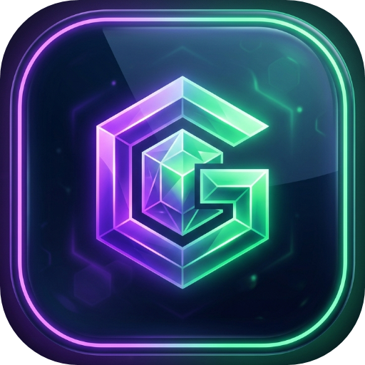

# 🛡 Goida Launcher v7.5

<p align="center">
  
</p>

<p align="center">
  <strong>Современный, высокопроизводительный и кастомизируемый оффлайн-лаунчер Minecraft для Windows</strong>
</p>

<p align="center">
  <a href="https://github.com/murkLol595/GoidaLauncher/releases/latest"></a>
  
  
  
</p>

---

## 🤖 Разработано с помощью ИИ (Google Antigravity & Gemini)

**Goida Launcher** спроектирован и разработан в тесном сотрудничестве с продвинутым ИИ-агентом **Google Antigravity** на базе моделей **Google Gemini**.

В рамках совместной разработки с ИИ были реализованы и оптимизированы ключевые технологии:
- 🧠 **Архитектура и сервисный слой:** асинхронные пайплайны скачивания ассетов и валидации библиотек Minecraft.
- 📦 **Движок автоматической установки модпаков (.mrpack):** чтение манифестов Modrinth, распаковка `overrides` и параллельная загрузка сотен модов с прогресс-баром.
- 👕 **Интерактивный 3D-движок скинов:** аппаратный рендеринг 3D-модели персонажа на WPF Viewport3D с поддержкой вращения мышью в реальном времени.
- ⚡ **Глубокая оптимизация производительности:** Memory Optimizer, сброс RAM при старте игры, устранение просадок FPS интерфейса, кеширование стилей и заморозка кистей (Freeze).
- 📦 **Система автономного установщика:** создание конфигурации и автоматизированной сборки Inno Setup 6 для развёртывания в один клик.
- 🛡 **Интеграция спецификаций агентов:** проект включает файлы [`AGENTS.md`](AGENTS.md) и [`GEMINI.md`](GEMINI.md) со стандартами разработки для автономных ИИ-ассистентов.

---

## 📋 Что нового в версии 7.5

- **Установка модпаков (.mrpack):** при установке сборки лаунчер распаковывает конфиги и скачивает все нужные моды напрямую в папку сборки, а не просто сохраняет `.mrpack` файл.
- **Каталог Modrinth:** добавлены иконки модов, кнопки перелистывания страниц (вперёд/назад) и фильтрация модов под выбранную версию игры и загрузчик.
- **Настройки:** переработан интерфейс вкладки настроек, параметры разделены по разделам (Общие, Память и Java, Оформление).
- **Скины:** добавлена галерея скинов и исправлено их отображение в списке (убрано размытие текстур).
- **Оптимизация и фиксы:**
  - Исправлен вылет Java при запуске игры (ошибка аргумента JVM `SurvivorRatio`).
  - Снижено потребление оперативной памяти лаунчером во время игры.

---

## 📥 Установка

Самый простой способ — скачать готовый официальный установщик:

👉 **[Скачать GoidaLauncher-Setup-v7.5.exe](https://github.com/murkLol595/GoidaLauncher/releases/latest)**

* Установщик автоматически настроит лаунчер, добавит ярлыки на рабочий стол и в меню «Пуск».
* Лаунчер полностью автономен (все компоненты .NET 10.0 уже зашиты внутрь).

---

## 🛠 Сборка из исходного кода

### Требования:
- Windows 10/11 x64
- [.NET SDK 10.0](https://dotnet.microsoft.com/download)
- Visual Studio 2022 (17.12+) с компонентом *.NET Desktop Development* (опционально)
- Установленная Java (Java 21 для Minecraft 1.20.5+, Java 17 для 1.17–1.20.4, Java 8 для 1.12–1.16)

### Сборка и запуск:
```bash
# Клонирование репозитория
git clone https://github.com/murkLol595/GoidaLauncher.git
cd GoidaLauncher

# Сборка проекта
dotnet build -c Release

# Запуск
dotnet run --project GoidaLauncher
```

### Публикация автономного EXE:
```bash
dotnet publish GoidaLauncher/GoidaLauncher.csproj -c Release -r win-x64 --self-contained true -p:PublishSingleFile=true -p:IncludeNativeLibrariesForSelfExtract=true
```

### Сборка инсталлятора (Inno Setup):
```bash
& "C:\Program Files (x86)\Inno Setup 6\ISCC.exe" installer.iss
```

---

## 📁 Структура проекта

```text
GoidaLauncher.sln
├── AGENTS.md                  # Инструкции для ИИ-агентов (Antigravity/Gemini)
├── GEMINI.md                  # Спецификация проекта для Google Gemini
├── installer.iss              # Скрипт сборки инсталлятора Inno Setup
└── GoidaLauncher/
    ├── App.xaml / .cs         # Глобальные стили, темы оформления и ресурсы
    ├── MainWindow.xaml / .cs  # Хост-окно с навигацией и статус-баром
    ├── Pages/
    │   ├── HomePage.xaml / .cs           # Главная страница: запуск, 3D персонаж, консоль
    │   ├── InstallVersionPage.xaml / .cs # Каталог версий и загрузчиков
    │   ├── ModrinthPage.xaml / .cs       # Поиск и установка модов Modrinth
    │   ├── SkinPage.xaml / .cs           # Управление скинами игрока
    │   ├── SettingsPage.xaml / .cs       # Настройки памяти, Java, тем и интерфейса
    │   └── SkinViewer3D.xaml / .cs       # 3D движок рендеринга модели персонажа
    ├── Services/
    │   ├── MinecraftService.cs    # Скачивание, проверка файлов и запуск игры
    │   ├── FabricService.cs       # Авто-установка Fabric
    │   ├── ForgeService.cs        # Авто-установка Forge (processors pipeline)
    │   ├── QuiltService.cs        # Авто-установка Quilt
    │   ├── ModrinthService.cs     # API поиска модов Modrinth
    │   ├── SkinService.cs         # Генерация оффлайн ресурспаков скинов
    │   ├── ThemeService.cs        # Движок тем оформления и акцентов
    │   └── DiscordRpcService.cs   # Нативный Discord Rich Presence
    └── Models/                    # Модели профилей, версий и манифестов
```

---

## 📄 Лицензия & Авторство

* **Проект:** Goida Launcher v7.5
* **Автор:** [murkLol595](https://github.com/murkLol595)
* **AI-партнёр:** Google Antigravity & DeepMind Gemini
